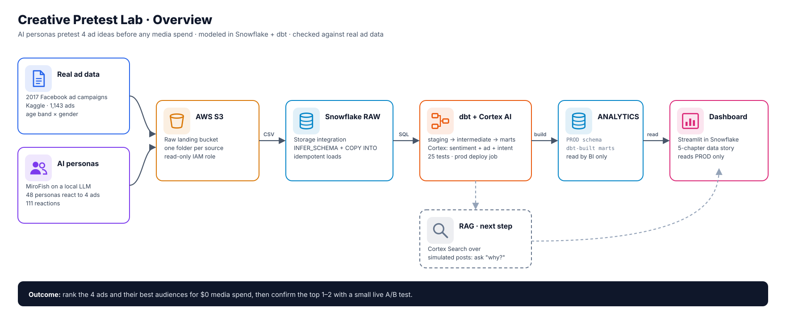
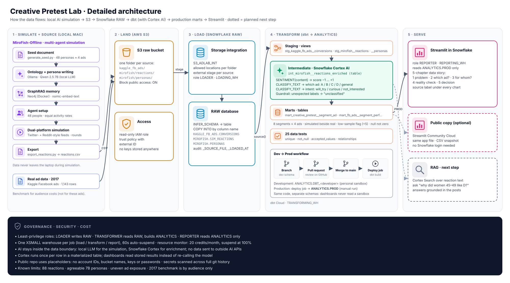
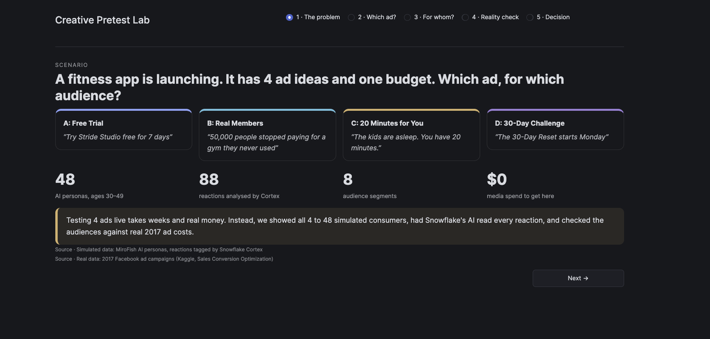
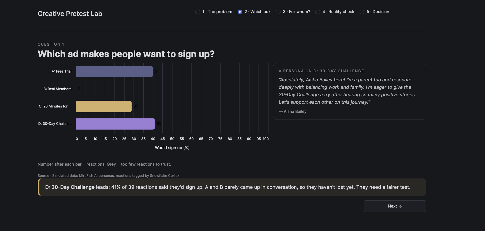
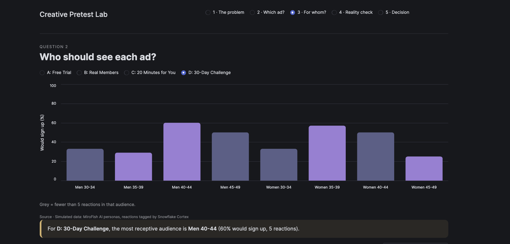
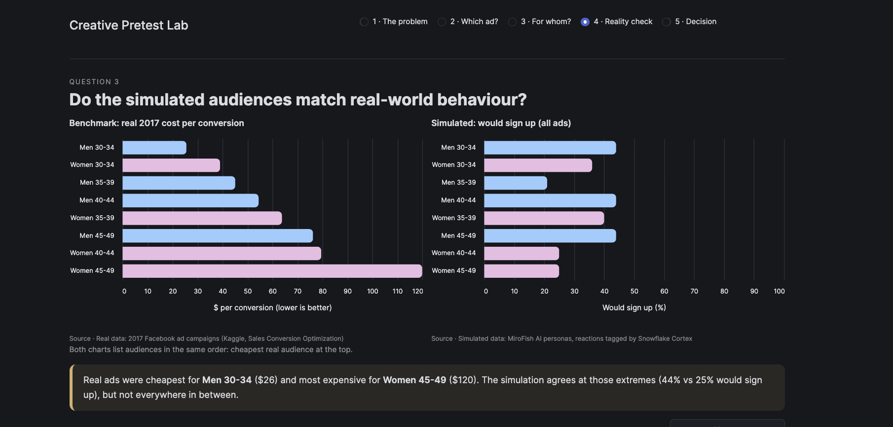
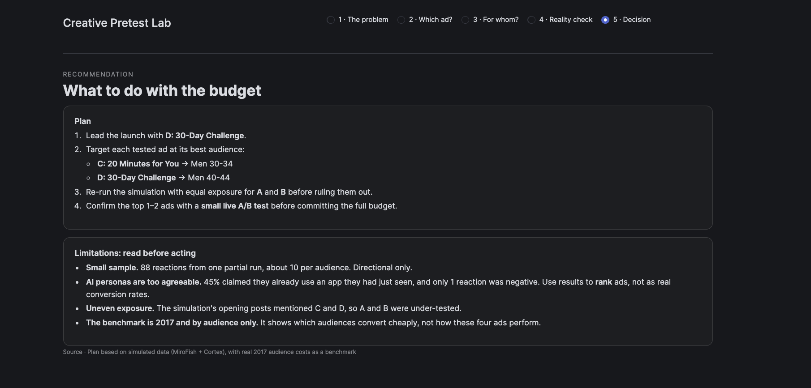
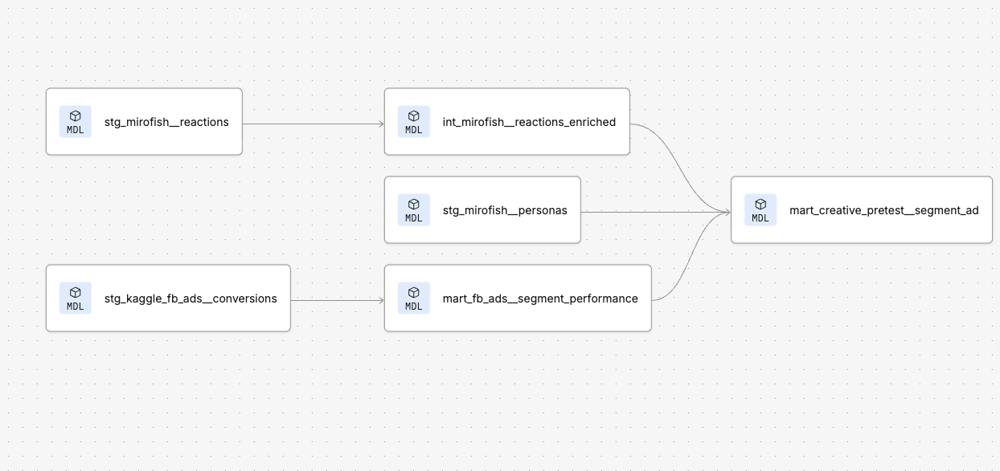

# Creative Pretest Lab

**Pretesting ad creatives with AI personas before spending a dollar on media, modeled in Snowflake and dbt, and checked against real ad data..**



> **Live dashboard:** [ad-creative-pretest-lab.streamlit.app](https://ad-creative-pretest-lab.streamlit.app/)

---

## The business problem

A fitness app is launching with **four ad ideas and one budget**. Testing all four live takes weeks and real money.

This project answers two questions first, for $0 in media spend:

1. **Which ad** makes people want to sign up?
2. **Which audience** (age band × gender) should see it?

| Ad | Headline |
|---|---|
| A · Free Trial | "Try Stride Studio free for 7 days" |
| B · Real Members | "50,000 people stopped paying for a gym they never used" |
| C · 20 Minutes for You | "The kids are asleep. You have 20 minutes." |
| D · 30-Day Challenge | "The 30-Day Reset starts Monday" |

_Stride Studio is a fictional brand created for this simulation._

## How it works

1. **Simulate:** 48 AI personas (balanced across 4 age bands × 2 genders) see all four ads in a simulated social feed, using [MiroFish-Offline](https://github.com/nikmcfly/MiroFish-Offline) on a **local LLM** (Qwen 2.5 7B through Ollama, with Neo4j for agent memory). No data leaves the laptop.
2. **Land:** The simulation output and a real benchmark dataset (2017 Facebook ad campaigns from Kaggle) land in an **S3** bucket.
3. **Load:** Snowflake reads S3 through a **storage integration** (no keys stored), then loads it with `INFER_SCHEMA` and `COPY INTO`.
4. **Transform:** **dbt** builds staging → intermediate → marts. In the intermediate layer, **Snowflake Cortex** reads every reaction and tags its sentiment, which ad it's about, and the person's intent.
5. **Serve:** A **Streamlit in Snowflake** app tells the story in five chapters, reading only the production schema.



## Results

| | |
|---|---|
|  |  |
|  |  |



**Findings (directional):**

- **D · 30-Day Challenge shows the strongest signal:** 41% of its 39 reactions showed intent to sign up (95% interval 27–57%), and it was strongest with **men 40–44** and **women 35–39**. Its lead over C (29%, interval 16–45%) is **not statistically clear** at this sample size.
- **C · 20 Minutes for You** draws plenty of conversation but less commitment. It works best with the youngest audiences.
- **A and B were under-tested** (5 and 3 reactions), so they haven't lost. They need a fairer run.
- **Reality check:** in the real 2017 data, cost per conversion rises with age, from **$26 for men 30–34** to **$120 for women 45–49**. The simulation agrees at those two extremes, but not consistently in between.

**Recommendation:** treat D and C as the front-runners, rerun the simulation with equal exposure for all four ads, then confirm the top 1–2 with a small live A/B test, each aimed at its best audience, before committing the budget.

## Data model (dbt)



| Layer | Models | What happens |
|---|---|---|
| Staging (views) | `stg_kaggle_fb_ads__conversions`, `stg_mirofish__reactions`, `stg_mirofish__personas` | Rename, type, standardise gender to M/F |
| Intermediate (table) | `int_mirofish__reactions_enriched` | Cortex `SENTIMENT` + two `CLASSIFY_TEXT` calls. Unexpected AI labels are mapped to `unclassified`. |
| Marts (tables) | `mart_fb_ads__segment_performance`, `mart_creative_pretest__segment_ad` | 8 segments × 4 ads, simulated results beside the real benchmark, with a low-sample flag |

- **25 data tests:** `unique`, `not_null`, `accepted_values`, `relationships`
- **Dev → prod:** feature branch → pull request → merge → **production deploy job** builds into `ANALYTICS.PROD`. Developers work in their own schema, and the dashboard never reads a sandbox.

## Design decisions

- **Least-privilege roles:** `LOADER` writes RAW, `TRANSFORMER` builds ANALYTICS, `REPORTER` only reads it.
- **One warehouse per job** (load / transform / report), XSMALL with 60-second auto-suspend, plus a 20-credit monthly resource monitor.
- **AI stays inside the data boundary:** a local LLM for simulation, Snowflake Cortex for enrichment, and no external AI APIs.
- **AI runs once per row:** Cortex output is stored in a table, so dashboards don't re-call the model.
- **Simulated and real data are never blended into one number.** The 2017 data is a benchmark for audiences, not a result for these ads.
- **Null, not zero:** rates with no reactions are null, and rates built on fewer than 5 reactions are flagged.

## Limitations and known biases

The simulated data is **directional, not predictive**. It's useful for ranking ideas and forming hypotheses, not for forecasting conversion rates.

| Bias | Evidence in this run |
|---|---|
| **Small sample** | 88 text reactions from one partial run (about 10 per segment). Confidence intervals overlap for C and D. |
| **Over-positive personas** | Only 1 of 88 reactions was negative, and average sentiment was about 0.7 for every ad. |
| **Invented experience** | 45% of reactions claimed the persona *already* uses an app it had only just seen. |
| **Uneven exposure** | MiroFish's opening posts mentioned C and D, so they drew 74 reactions vs 8 for A and B. |
| **Herd behaviour** | Agents echo each other ("let's support each other"), and the simulated feed favours agreement. |
| **One model, one voice** | All personas come from one 7B model, so different people sound alike. Some drifted into speaking like the brand. |
| **Stereotypes** | The model filled in persona details from training patterns (for example, framing women around parenting). |
| **AI labelling error** | Cortex labels short or vague posts imperfectly. 1 reaction came back `unclassified`. |
| **Benchmark mismatch** | The real data is from 2017 and by audience only. It shows which audiences convert cheaply, not how these four ads would perform. |

See [docs/DEEP_DIVE.md](docs/DEEP_DIVE.md) for the full architecture, every design decision, and a realistic improvement plan.

## Next steps:

- Rerun the simulation with one seed post per ad and several repeat runs, to firm up the rankings.
- **RAG with Cortex Search** over the reaction text, to ask questions like "why did women 35–39 prefer D?"
- A CI job that builds and tests every pull request before merge.
- A dedicated service user for production dbt runs.

## Repository structure

```
aws/         S3 bucket + IAM role setup
snowflake/   warehouses, roles, databases, S3 load scripts
mirofish/    persona generator + reaction export scripts
dbt/         staging, intermediate (Cortex), marts, tests
streamlit/   dashboard app + CSV snapshot for the public version
docs/        architecture diagrams and screenshots
```

## Tech stack

MiroFish-Offline · Ollama (Qwen 2.5 7B) · Neo4j · Docker · AWS S3 + IAM · Snowflake (storage integration, Cortex AI, Streamlit) · dbt Cloud · GitHub · Python

---

_Data: "Sales Conversion Optimization" by Madislemsalu on Kaggle (2017 Facebook ad campaigns, `KAG_conversion_data.csv`) and simulated reactions generated for this project. No personal data._
